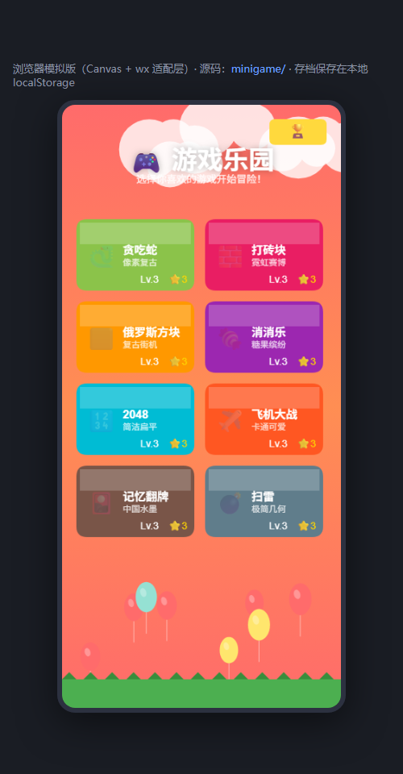
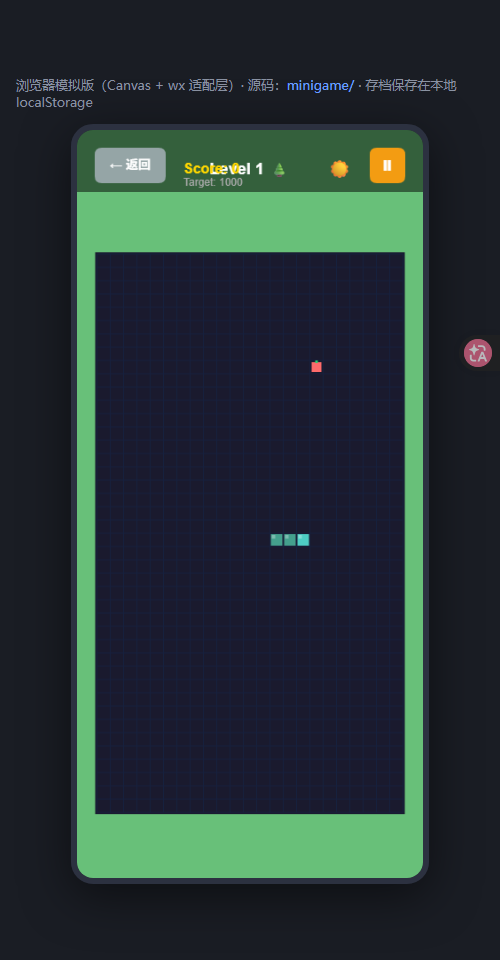
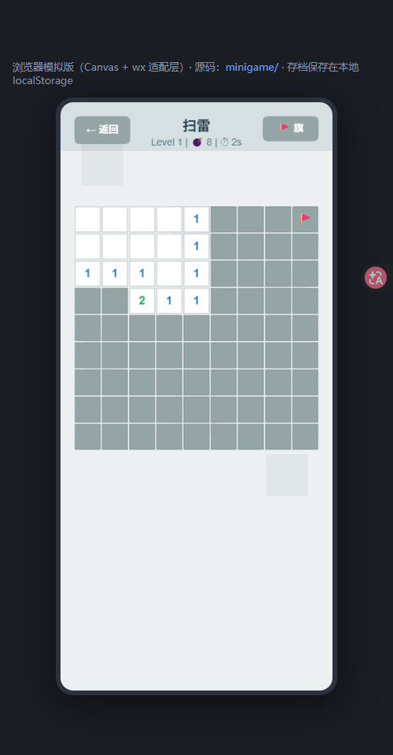

# 游戏乐园 · Game Park

微信小游戏合集：8 款完整小游戏，加一套自己写的 Canvas 场景框架。零第三方依赖，渲染、碰撞、UI、存档全部手写。



*主页 · 全部解锁状态（演示存档）；初始状态按累计星星逐款解锁*

## 在线试玩

[浏览器模拟版](https://qqquan2.github.io/InventoRY/game-park/demo/) — 无需安装，鼠标或触屏直接玩，存档保存在浏览器 localStorage。

微信小游戏源码只用到 6 个 `wx` 接口（`createCanvas`、三个触摸事件、`getStorageSync` / `setStorageSync`）。浏览器版用 [demo/wx-shim.js](demo/wx-shim.js) 适配这 6 个接口，游戏逻辑代码与 [minigame/](minigame/) 完全一致：[demo/bundle.js](demo/bundle.js) 由 [tools/build-demo.js](tools/build-demo.js) 直接从小游戏源码打包生成，没有另写一套。

 

*左：贪吃蛇运行中　右：扫雷连锁揭示与插旗*

## 内容

8 款游戏：贪吃蛇、打砖块、俄罗斯方块、消消乐、2048、飞机大战、记忆翻牌、扫雷。每款 12 个关卡，关卡配置含地区、时段、天气与难度系数；通关按用时或尝试次数评 1–3 星，关卡解锁与最高分存本地。

## 结构

```
game-park/
├── minigame/                # 微信小游戏源码（可直接导入微信开发者工具）
│   ├── game.js              # 入口
│   ├── game.json            # 竖屏与网络超时配置
│   ├── project.config.json
│   └── js/
│       ├── core/
│       │   ├── Game.js          # 主循环、触摸事件、场景栈
│       │   ├── BaseScene.js     # 场景基类：按钮 / 动画 / 元素
│       │   ├── DataManager.js   # 本地存档（含默认字段合并）
│       │   └── LevelSystem.js   # 关卡 / 地区 / 天气 / 难度
│       └── scenes/
│           ├── HomeScene.js        # 主页与游戏卡片
│           ├── GameSelectScene.js  # 关卡选择
│           └── games/              # 8 款游戏，各一个场景类
├── demo/                    # 浏览器试玩：wx-shim + 自动生成的 bundle
├── tools/build-demo.js      # 源码 → bundle 的打包脚本（无第三方依赖）
└── docs/                    # 截图
```

## 本地运行

**微信开发者工具**：导入项目时选择 `minigame/` 目录。`project.config.json` 里 `appid` 是占位值 `wx0000000000000000`，用测试号或改成自己的 AppID 即可。

**浏览器**：在仓库根目录起一个静态服务，访问 `/game-park/demo/`。改动小游戏源码后重新生成 bundle：

```powershell
node game-park/tools/build-demo.js
```

## 实现要点

- 场景用 `switchScene` / `pushScene` / `popScene` 管理；所有游戏继承 `BaseScene`，新增一款游戏只需写场景类并在主页、选关页各登记一行。
- 帧循环统一计算并限幅 `deltaTime`，按钮命中在 `touchend` 判定；`BaseScene.createButton` 做了幂等处理，结算界面重复渲染不会堆积按钮。
- 存档读取时与默认结构合并，避免版本更新后字段缺失；进度、星星、最高分都落本地。
- `LevelSystem` 按关卡轮换地区、时段、天气（雨 / 雪 / 雾 / 雷暴）与难度系数，游戏场景读取配置调整速度与分数。

## 上传前修复

- 补齐缺失的 `MinesweeperScene.js`：原主页和选关页都登记了扫雷，但文件不存在，点进去会直接报错。
- 修复 `HomeScene` / `GameSelectScene` 中箭头函数捕获错误 `this` 的问题：此前关卡按钮无法进入游戏、主页卡片锁定判断也失效。
- `BaseScene.createButton` 幂等化，解决各游戏结算界面每帧重复创建按钮的问题。

## 状态

界面为早期版本，后续计划重做视觉；当前版本以功能完整、可运行为准。

## 许可

MIT，见 [LICENSE](LICENSE)。
